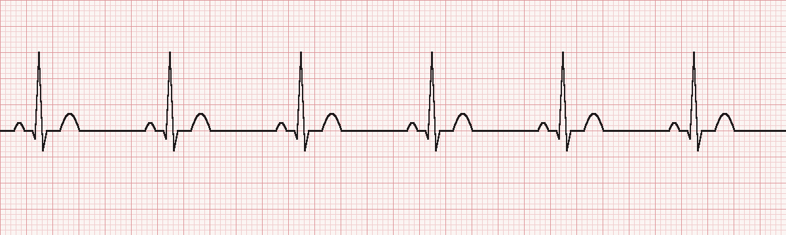

Every call starts the same way: you walk in knowing almost nothing, and you have a few minutes to build a picture you can act on. That turns out to be most of debugging, too.

## Start with the scene, not the patient

Before touching anything, look around. In software that means reading the error, the logs and what changed recently before reaching for a fix.

> Treat the patient, not the monitor. The same goes for the stack trace.



## Work the checklist

- What exactly is the complaint?
- When did it start, and what changed?
- What have you already tried, and what happened?

```sh
$ git log --since="yesterday" --oneline
a41c2e9 move data fetch behind cache
9b07d11 bump market data client
```

Nine times out of ten, the answer is in the last thing that changed. I wrote about the project that taught me this in [[a-joke-website-my-coworkers-use]].
