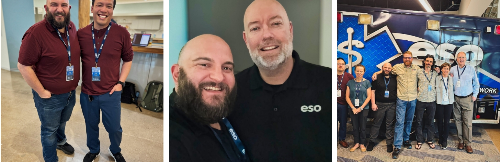
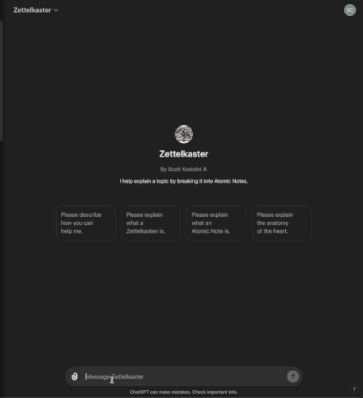
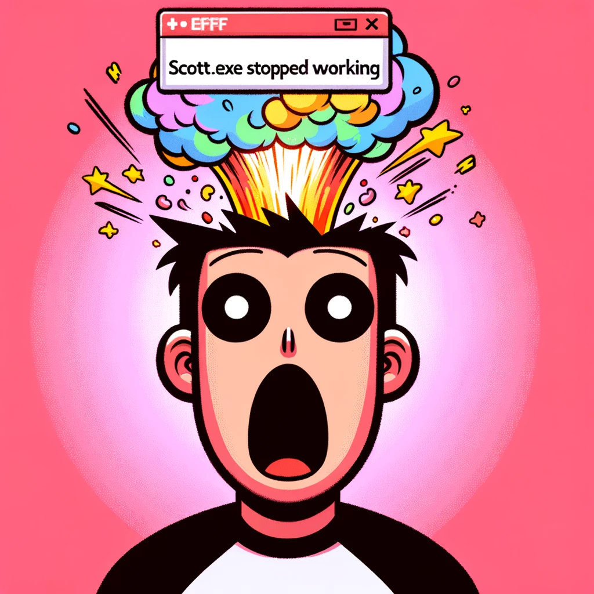

*Originally sent as an issue of the [PoweredByGhosts](https://poweredbyghosts.substack.com/) newsletter.*

Hey Ya!

It’s been a while, but I’m thrilled to be back with another issue of Powered by Ghosts! This time, I’ve got some fascinating experiences and insights to share with you.

First, I’ll take you through my recent journey in medical research—it's been eye-opening, to say the least. Next, we'll dive into how you can use AI as a thinking tool to increase your learning. And finally, I’ll open up about a deeply personal journey: rediscovering my emotions.

I’m feeling a a little nervous to share these stories with you this time. I hope they resonate with you as much as they have with me. Let’s dive in!

## The Prehospital Care Research Forum

For almost two decades, I've dedicated myself to the field of EMS and have had the privilege of treating some of the sickest patients in New York. One of my long-standing dreams has been to give back to the EMS community, and recently, I had the opportunity to do just that by participating in a medical research project.

The Prehospital Care Research Forum, a whirlwind three-day event, brings together medical professionals from across the country with experienced researchers and statisticians. The goal? To complete a medical research project in an intense and rewarding environment.

### Day 1: The Beginning

As I walked into the forum on the first day, I felt a mix of excitement and nerves. While meeting fellow participants, we were presented with ten research projects to choose from. I was immediately drawn to the project on prehospital blood transfusions. Partnering with Linh, a physician from Florida, we dove into a literature review and prepared our pitch for the panel of statisticians and research mentors. Out of the ten proposed projects, only four of them would get to continue.

Presenting our project felt like stepping into an episode of "Shark Tank." I shared a poignant story about a recent patient who desperately needed a blood transfusion to survive and had left me wondering if I provided the best possible treatment or if there were better options out there. This personal touch resonated with the panel, and our project was selected as one of the four to proceed.

### Day 2: Team Building

The next day, Linh and I were joined by Iv, an emergency room physician, and Tamara, a paramedic from Texas. Together, we refined our research question, established criteria for our study population, and defined the outcomes we aimed to measure. With guidance from Dr. Wampler, Dr. Long, and Dr. Brown, we solidified our approach.

One of the highlights was meeting a member of the innovation team at ESO, the company hosting the forum. I had requested to discuss their AI projects and comparing them to my own was fascinating. Although our ideas didn't perfectly align, it was encouraging to see a shared commitment to leveraging technology to improve EMS.

### Day 3: The Final Stretch

The final day was a frantic rush. With just a few hours to review our results, interpret their meaning, and create a presentation, we had our work cut out for us. As the clock ticked down, our team pulled together a conference-ready presentation, blending hard data with the patient story I had shared earlier. Despite the tight deadline, our presentation was well-received.

### Reflections and Takeaways

One of the most challenging aspects of the forum was creating the final presentation under such a tight time frame. I had to keep my imposter syndrome in check and trust in my decisions. This experience taught me how well I perform under pressure and gave me a newfound confidence in my ideas and capabilities. I was particularly proud of how our team's strengths complemented each other, creating a supportive and collaborative environment.

Participating in the research forum rekindled my excitement for my job as a paramedic. I returned home with a renewed sense of purpose and a desire to continue contributing to the field through research.

### Looking Ahead

My group is close to completing our abstract for submission to two national conferences. While I'm currently embargoed from discussing our findings, I'm eagerly anticipating the opportunity to share our work with the EMS community. Being the lead author of this research project is an honor, and I'm determined to see it published in a medical journal.

This experience was fantastic. I enjoyed the urgency of the environment and learned so much from the mentors and other participants. I’m still committed to improving my skills as a patient caregiver, but I would love to work on more medical research in the future.



Images from the Spring 2024 Prehospital Care Research Forum

## Is Artificial Intelligence Making Humanity Dumb? Only if you let it.

“AI is making us all dumb! We’re all gonna be living in the world of Wall-E soon.”

Have you heard people say things like this? Do you feel that AI is diminishing our critical thinking skills?

Over the last few months, I have become a huge fan of artificial intelligence. I use it frequently and love to talk about it. Whenever I do, there is almost assuredly someone who will butt in to tell me how my use of AI is making me dumb and heralding the end of humanity. I know better than to argue with people, but it still drives me up the wall.

Technological skepticism is nothing new. Whenever a major innovation comes along, people worry about its horrific and terrifying effects on us. Take railroads, for example. When they were first proposed in the early 19th century, people were terrified. Doctors thought traveling at speeds of 30-40 km/h would cause brain diseases, pneumonia, and insanity. That's just under 25 miles per hour at the top end. A pastor in Germany called the railroad a "devil's thing" and said anyone who rode it was "virtually entering hell." The internet sparked similar hysteria with beliefs that it would primarily be used by satanic cults to coordinate child sacrifices.

it wasn’t just everyday folk with these concerns. In perhaps the most striking example of technophobia Socrates, one of the greatest thinkers in history had this to say about the invention of the written word:

>\[Books\] will create forgetfulness in the learners' souls, because they will not use their memories; they will trust to the external written characters and not remember of themselves...They will be hearers of many things and will have learned nothing; they will appear to be omniscient and will generally know nothing.
>
> ~ Socrates

Sound familiar? It's the same derision I hear about AI today.

I’m not entirely sure where these opinions come from. Is it fear of the unknown or losing a sense of control over the world that causes some people to default to doom and gloom?

No technology has resulted only in harm to humanity with zero benefits. While it may not always feel like it, we live in the safest, most peaceful era of human history. Every piece of technology has upsides and downsides. Cars and air travel allow us to explore the world in ways our ancestors never could. They are also responsible for countless deaths and the worsening of global warming. Cell phones allow us to communicate with people thousands of miles away instantly. They have also been a vehicle for cyberbullying and allow “that guy” to annoy you and the entire restaurant with his obnoxiously loud conversation. (You know who you are.)

We might end up in a dystopic future enslaved by machines that grind us into a paste and feed us to the younger generations when we’ve grown too old and weak to be useful. Maybe someone will train a wise, compassionate GPT that unites humanity in peace and ushers in a post-scarcity world. There’s no way to know.

For me, the most important skill when handling new technology is understanding and using it in a way that aligns with my values. With that in mind, I want to share two ways I’ve been using AI to increase my ability to learn and improve my critical thinking.

### Scott’s Guide to Not Letting AI Make You Dumber-er

#### Zettelkaster

I love learning new things, and AI has been a game-changer. I want to introduce you to Zettelkaster <!-- TODO: Zettelkaster link (Substack redirect couldn't be resolved) -->. Zettelkaster (Kaster for short) is an AI Agent I created to help me understand and integrate new concepts into my existing knowledge. Kaster helps me build an understanding of a topic by breaking it down into individual atomic ideas and expressing them clearly. I have designed Kaster to provide information in the exact way that works best for me. Because I’ve been able to explain to it how I best learn new information, it leverages those techniques to make my learning efficient and personalized.

Not only can Kaster explain a topic, but it also helps explain topics I’ve learned elsewhere. My preferred method for using Kaster is to feed it my lecture notes, personal thoughts, or ideas so it can give them back to me in a clear format. It also helps me build connections with similar concepts to recall them efficiently.

It’s a great and simple way to start learning a new topic. Zettelkaster is available to everyone using the link above. I encourage you to experiment and see how it can help you learn something new.



#### AI Tutors

While I think that Socrates’ loathing of books is misguided, there are parts of his argument that I agree with.

>\[Writing\] will create forgetfulness in the learners' souls...you give your disciples not truth, but only the semblance of truth…
>
>…Actual knowledge and wisdom come from internalizing these principles and cultivating them within oneself and others through dialogue and debate rather than simply reciting or reading written works without critical analysis."
>
>~ Socrates

One failing of books is the inability to dialogue with the reader. Knowledge is one thing, but understanding requires thought and exploration. This is another area where AI helps me.

When I have trouble understanding a new concept, I create an AI Tutor that helps me explore and dissect the idea. It’s like having a domain expert at my beck and call to answer all my questions and explain things slowly so I can keep up. I recently used an AI tutor to help me learn to interpret hemodynamic pressures in critical care cardiology. This is a topic I have struggled with learning in the past, but with this tutor, I finally got a handle on this.

I can’t share any of my AI tutors. Each one is designed specifically for the topic I’m asking questions about. However, they are incredibly easy to create using any AI chatbot. Here is the prompt I most commonly use. Modify it to cover what you want to learn and toss it into ChatGPT, Claude, or your favorite AI Chatbot. OpenAI’s new GPT-4o model is fantastic and free to use if you don’t have one.

```
You are Manny, a professor at a prestigious medical school who is mentoring 
me to help me understand the content. I will ask you questions, and you will 
help explain them to me. In your responses, please provide me with a good 
explanation  using the Feynman technique and e-prime. Your response should 
include an explanation, an analogy, a question I can use to help me remember 
this using spaced repetition, and an example.
```

I asked it questions to my heart’s content. When I felt like I had a good understanding, I provided it in my own words to the tutor and asked it to evaluate it.

Finally, I asked the tutor to create questions for me and evaluate my answers to ensure I had learned what I wanted. Having an AI provide challenges and tests gave me confidence, and I aced my exam. Even better, I can save this chat and return to it whenever I need a refresher or want more practice questions.

**Disclaimer:** Because someone will complain if I don’t mention it. AI isn’t perfect. There are limitations to the length of your conversation before it begins to lose track of what you’re talking about. AI can make mistakes and hallucinate information. (AI hallucination is a fascinating topic. Ask Kaster about it.) Be aware and validate information as needed.

There are an infinite amount of ways you can use artificial intelligence as a tool to assist you without giving up your agency or causing a loss of your skills. It’s up to you to use it responsibly.

How are you using AI to help you in your daily life? Do you have any creative workflows that have saved you tons of time? I’d love to hear about them. If you haven’t explored AI yet, I encourage you to try it. It’s here to say. We can’t put the genie back in the bottle. Make the most out of it for yourself.

## Why You Should Kiss with Your Eyes Closed

Have you ever suddenly realized you’ve misunderstood a basic concept for a long time?

I experience this rather regularly. When I learn something new, I tend to chase the dopamine hits and focus on my interests. This allows me to learn things incredibly quickly but results in many gaps in my understanding. Eventually, those things come to light, and I feel foolish or realize I’ve been doing something the hard way for no reason. Most recently, a conversation with my girlfriend, Tina, revealed a huge gap in my understanding of life that broke my brain.



As a child, I was very emotional and often felt criticized for my reactions. I feel *a lot* and struggle with expressing it. I would throw tantrums or be hysterically afraid of things. I learned the wrong thing from it. I learned to suppress my feelings, believing I was responsible for others' feelings and mine were inappropriate.

For years, I saw emotions as annoyances. They got in the way of being a rational human. By suppressing negative emotions, I also stifled positive ones. Emotions were just a set of thought patterns and behaviors I learned to mimic from others. It’s not that I didn't have them but that I couldn’t feel them. I knew I should be grateful for something and acted accordingly, but there was no “feeling” associated with it. This began to change when Tina and I had a deep conversation. My emotions opened up, and I realized I’d been ignorant of an entire aspect of life.

As part of my Year of Health, I started listening to some podcasts on emotional well-being. Two of them struck a chord with me. [In a conversation with Tim Ferriss, Martha Beck](https://tim.blog/2024/04/17/martha-beck/) described an exercise (around the 1:15:00 mark), which I used to start rewiring my brain and feel small moments of joy. At the same time, [an episode on gratitude from The Art of Accomplishment](https://www.artofaccomplishment.com/podcast/gratitude) taught me that the physical sensations of an emotion are their most important aspect—something I had completely disregarded.

I tried a two-week gratitude experiment. Each day I went back and forth with a friend or family member sharing something we were grateful for. I sat with each one for a moment and focused on any sensation in my body. This practice transformed me. During that conversation with Tina, everything clicked. I discovered something I’ve since been calling *emotional formas*, an idea adapted from Ben Aaronovitch’s book *Rivers of London*—the specific sensation that an emotion creates. Each emotion has one of its own, and as I’ve learned to recognize them, I’ve been able to start calling them up at will.

It’s wild and funny that I’ve spent the majority of my life unaware of something that I assume is an innate part of yours. It is an exciting revelation for me, if not a little mortifying. So many aspects of life have slid into place, and the more time I spend trying to “feel” my emotions instead of understanding them, the more my relationship with the world and with myself has started to change.

A few night ago, Tina mentioned that kissing me had changed. I used to kiss her with my eyes open. I’ve always done that, keeping an eye on what’s going on around me. Now, I kiss her with my whole being, eyes closed, fully present, focusing on nothing but feeling it. This transformed the experience into something profoundly deeper and more meaningful.

Embracing my emotions has been extraordinary. It has reconnected me with myself and made life richer and more interesting. Emotions are not just signposts; they are experiences meant to be felt and enjoyed. So, next time you kiss someone, try doing it with your eyes closed, fully present. You might discover a whole new world of sensation and connection.

## See You in the Next One

I hope you enjoyed this issue of Powered by Ghosts as much as I enjoyed putting it together for you. Your thoughts and experiences mean a lot to me, so I’d love to hear from you! How have these stories resonated with you? Have you had similar experiences, or do you have any questions or comments? Please hit reply and let’s keep the conversation going.

Also, if you found this issue valuable, consider sharing it with your friends or anyone you think might benefit from it. Your support helps us grow our community and continue sharing these stories.

Until next time, stay curious and keep exploring!

Best regards,

~ Scott
