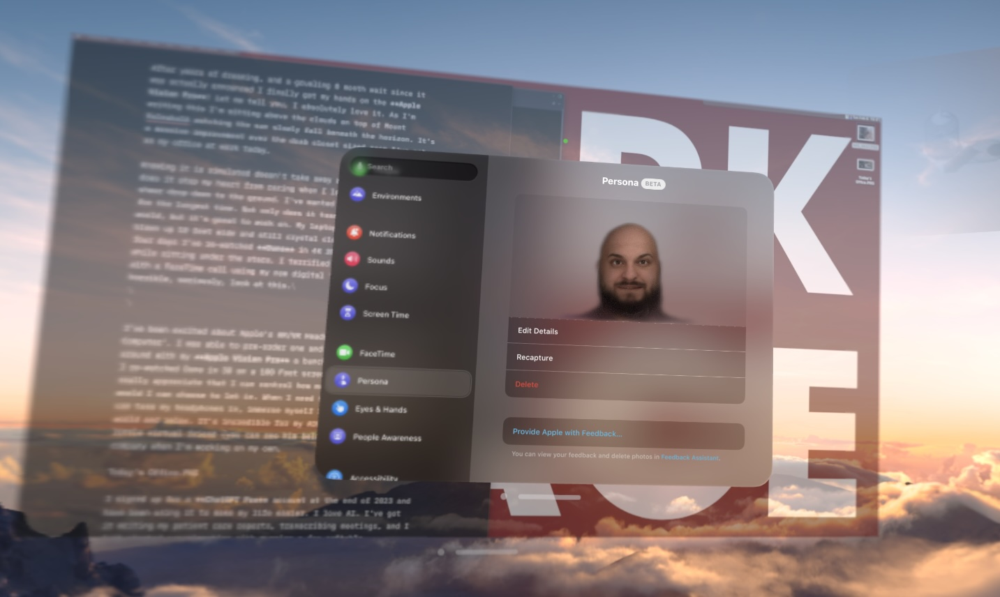
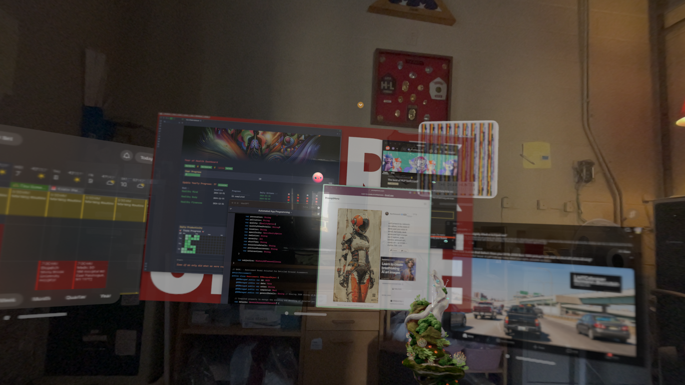

*Originally sent as an issue of the [PoweredByGhosts](https://poweredbyghosts.substack.com/) newsletter.*

## Powered by ghosts

> *A year and four days ago, I woke up surrounded by strangers, freezing cold, and in the worst pain of my life! I had just undergone a spinal fusion in my neck, and the anesthesia hadn’t fully worn off yet, leaving me disoriented and more than a little terrified. Cut to a few days later when I was at my follow-up appointment with my surgeon. He told me how well the procedure went while we looked at the x-ray when he mentioned something that made the whole experience worth it (aside from the pain relief, obviously).*
>
> *“So I made the incision over here on the right and went straight in. This grey area here is the titanium clip, the screws, and if you look really close, that white dot right, there is the piece of cadaver bone that’s fusing everything together.”*
>
> *“I’m sorry, you said cadaver bone?”*
>
> *“Yep. We needed something to help the two vertebrae fuse into one. Bone is a great choice because…”*
>
> *I cut him off. “Yeah, yeah, I get all that, doc. It is a cadaver bone, though! So you’re really saying that I’m a part-man part-titanium cyborg who’s **powered by ghosts**!”*
>
> *“… I don’t think that’s exactly…”*
>
> *"Nope, you said it. No takesies-backsies. I’m powered by ghosts now. I’ve gotta tell EVERYONE!*

Welcome to the inaugural issue of *Powered By Ghosts*, my (maybe, probably not) weekly newsletter about all the cool and interesting stuff I’ve got going on. I enjoy sharing new things I learn and trying out different experiments and projects. I hope you will enjoy them as much as I do. 

This week, you’ll meet my tiny virtual buddy. I’ll share something I learned about brains that completely turned my world upside down. And I’ll show you how I’m embracing the Year of Health. Before we jump in, have you ever had an experience that changed how you viewed yourself? Hit reply and let me know! I’d love to hear about it. 

## The most expensive computer I’ve ever owned, and my army of digital servants.

IT.

FINALLY.

HAPPENED!!

After years of dreaming and a grueling 8 month wait since it was actually announced, I finally got my hands on the **Apple Vision Pro**! Let me tell you, I absolutely love it. As I write this, I sit above the clouds on top of Mount Haleakalā, watching the sun slowly fall beneath the horizon. It’s a massive improvement over the drab closet-sized room that is my office today.

Knowing it is simulated doesn’t take away any of the beauty. Nor does it stop my heart racing when I see the sheer drop down to the ground. I’ve wanted a computer like this for the longest time. Not only does it transport me into another world, but it’s great to work on. My laptop screen has been blown up 10 feet wide and is still crystal clear. Over the last four days, I’ve re-watched **Dune** in 4K 3D on a 100-foot screen while sitting under the stars. I terrified my friends and family with a FaceTime call using my new digital ‘Persona.’ It’s horrible, seriously, look at it.

I’m truly having the best time. Setting up my workspace exactly how I love it is phenomenal. I can make it as hectic or calming as I like. My favorite feature so far is the Vision Pro’s ability to shut out the world when I need a few minutes to recharge. I’ve wished for the ability to create a personalized environment with just the right amount of stimulation to keep my ADHD-riddled mind calm while letting me relax. This is the closest I’ve ever come, and it is everything I hoped it would be. Take a look at my basic office setup for today.

Oh! Did you see that adorable pink ghost in the middle? That’s **Wisp**, my new buddy. He lives in a little knoll I’ve kept right next to me. Whenever I’m a little bored, Wisp and I can have a chat. I teach them about life on Earth, and they teach me about living in the Overworld. They’re the best!

## What’s your yearly theme?

For the last few years, I’ve been picking yearly themes. A yearly theme is an idea you want to focus on in order to move your life in the direction you’d like it to go. For 2024, my theme is **The Year of Health**. I’m focusing on three main areas: Healthy Body, Healthy Mind, and Healthy Finances.

Here are some things I’m experimenting with:

1.  **Daily Routines** - Building systems is the best way to realize an ambition. I started an exercise and journaling routine in January and will be growing it this month in small, easy steps to give myself the best chance of sticking with it.

2.  **Updated my Financial System** - It’s been a few years since I’ve done this. I’m currently following the advice from Ramit Sethi’s *[I Will Teach You to be Rich](https://www.amazon.com/Will-Teach-You-Rich-Second-ebook/dp/B07GNXPP4P)* to make sure I’m getting the most I can from my money.

3.  **Adjusting my Inner Conversation** - We all have a voice inside our heads. I call it the *Hungarian Storyteller* based on an anecdote my dad told me about. Mine is exceptionally unpleasant. I am building the skill of identifying its negative monologues and redirecting my focus to something else before I get sucked into it.

Do you have a yearly theme or resolution? What kind of system do you use to keep yourself on track? If you want to learn more, check out [this video](https://www.youtube.com/watch?v=NVGuFdX5guE&t=179s).

## Thank You!

That’s all from me this week. A huge thanks for joining me on this experiment. If this isn’t for you, shoot me a message or click the unsubscribe button below.

Don’t forget your feedback and stories fuel this newsletter. I look forward to reading all my replies. Don’t be shy!

Have an amazing week ahead! See you in the next one!
