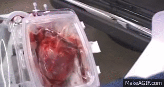
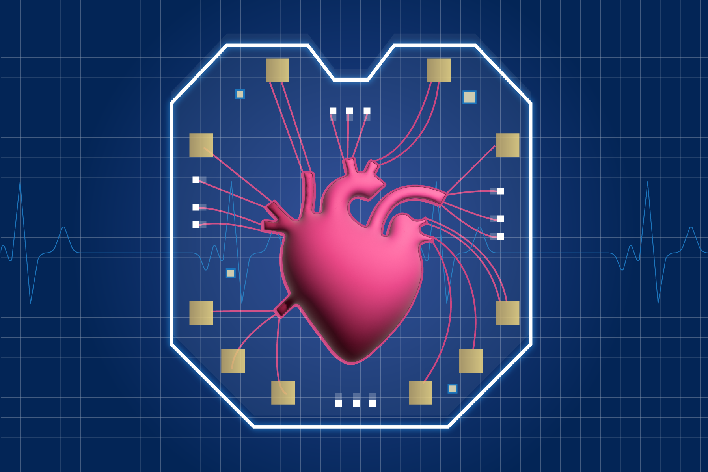
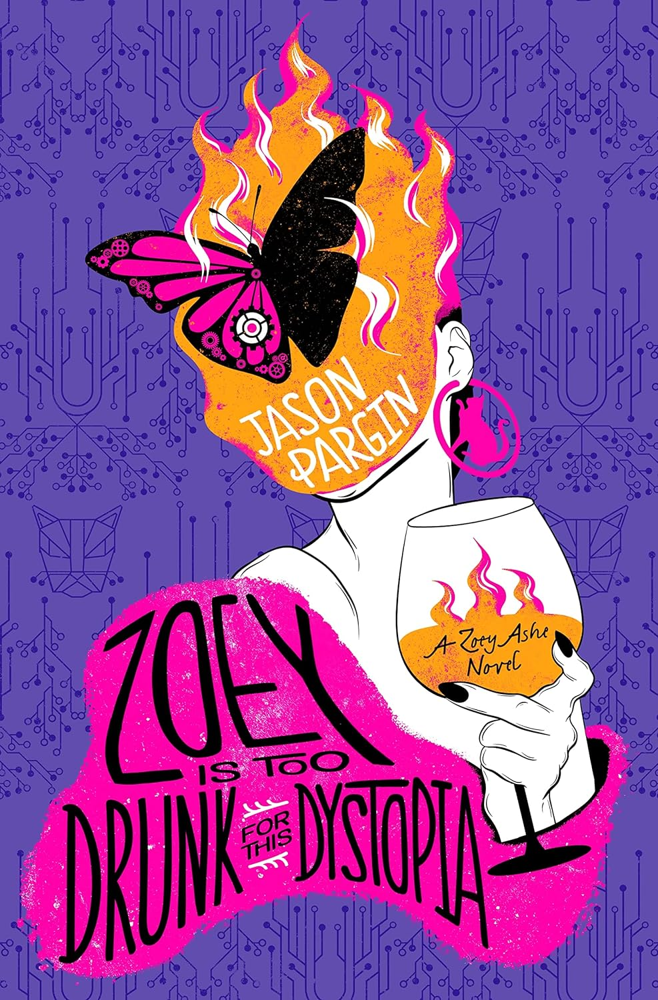

*Originally sent as an issue of the [PoweredByGhosts](https://poweredbyghosts.substack.com/) newsletter.*

Hello friends! Welcome back to *Powered by Ghosts*, my newsletter, where I talk about the new and exciting things I discover.

This week we explore why researchers are putting vaginas on microchips, I share some insights from one of my current reads, and I get to share some exciting news!

But first, a heartfelt thanks to everyone who engaged with the previous email—your thoughts and perspectives make writing these emails rewardin. Please keep the conversation going!

Know someone intrigued by the mysteries of health, technology, or personal growth? Invite them to join our conversations at [poweredbyghosts.substack.com](https://poweredbyghosts.substack.com/).

## You've heard of Heart in a Box, but have you heard of Heart-on-a-Chip!?

(I know, it doesn't rhyme)

Heart in a box traveling to its transplant recipient! How cool is this?

I was all set to tell you about the recent advancements at Neuralink and functioning lab-grown brain tissue. I'll likely come back to that second one. (*How much tissue is needed until consciousness starts emerging?*) When I stumbled upon an article about **THIS**, I had to write about it.

Imagine this: A miniaturized heart, not in your chest, but on a microchip, beating with life's rhythm. It sounds like a device you'd find on The Enterprise, but it's not. Organ-on-a-chip (OoC) models are a cutting-edge method researchers use today to study human organs. In these models, organ tissues are grown inside a microsystem chip, providing an environment mimicking human physiology. Organs that have already been "chipped up" include lungs, kidneys, and, yes, even vaginas.

The brilliant minds at the National Institute of Standards and Technology most recently developed a "Heart-on-a-Chip" model using a semi-permeable membrane that allows the cells to communicate locally. This model is being used to unfold the mysteries of heart disease, the number one killer in the United States.

Why does this matter? These chips are revolutionizing our fight against diseases, offering a lens into the cellular impact of illnesses and drugs. Scientists can see the effects of disease on functioning organ cells at a level that wasn't previously possible. It is not only for diseases. Pharmaceutical manufacturers are using these models to replace animal testing altogether!

I get a charge from reading about advances like these. They are equal parts futuristic and up lifting. What kind of technological advances make you excited? Would you consider joining me as a cyborg and replacing an organ with one grown in a lab?

## What I'm Reading: Reflecting Reality Through Sci-Fi

This month, I've been enjoying 'Zoey is Too Drunk for This Dystopia' by Jason Pargin, the author of 'John Dies at the End' under the pseudonym David Wong. Pargin has a knack for weaving together wildly absurd scenarios with irreverent humor. At a glance, these books look like juvenile entertainment. Still, they delve into complex issues such as mental illness, power dynamics, and the normalization of violence against women. What I appreciate the most about Pargin is that he allows the reader an opportunity to reflect on heavier themes while wrapping them up in absurdity or the occasional dick joke to prevent them from feeling oppressive.

I use these novels as a break between heavier books. Still, even so, in each one, I inevitably find a handful of passages that make their way into my Zettelkasten. Here’s my most recent highlight from 'Zoey is Too Drunk for This Dystopia':

"Games teach a really bad lesson, which is that every problem has some neat solution. You enter a room, there's a door, that means there must be a key that opens that door. And there's a sword in that room, and that must mean you'll need it to kill the dragon later.

But in real life, you don't get that. You think there's some perfect way for society to handle sex work, or policing, or just vice in general? That it's just a lock that needs the right key. The real world isn't like that. It's all just a bunch of trade-offs."

Have you encountered books or other media that masterfully blend genres to uncover deeper truths? A story that uses humor to open the door to more severe contemplation? I'd love to hear about your finds and the insights they've sparked.

## Charting New Horizons in EMS

The giants in medicine, those I've always admired, are relentless learners and innovators. I've dreamt of diving into medical research to push the boundaries of pre-hospital care. While I've dipped my toes in collaborative projects, leading a study of my own hasn't been much more than a dream--until now.

I'm excited to share that I've been accepted into UCLA's Pre-Hospital Care Research Forum! This May, I'll be heading to Austin, Texas, to immerse myself in a world of resources, education, and mentorship dedicated to EMS research.

Giving back to the field that has been a source of fulfillment in my life through research has been long on my list of goals throughout my career in EMS. There are many questions to answer and opportunities to deepen our knowledge. I'm eager to dive into them and give providers information they can use to connect with their patients and provide a higher level of medical care.

But enough about me—I want to hear from you! Have you ever visited Austin? I'm compiling a must-do list for my downtime. From famed eateries to hidden gems, I'd love your recommendations. And if you've ever ventured into medical research or have questions you want answered, let me know by hitting that reply button! I want to work on something that will benefit everyone!

## Wrapping Up!

Whew! This email ended up longer than I intended. If you stuck with me till the end, I applaud you. It means tons that you took the time to read it.

Your responses and feedback motivate me to keep writing. Let me know your thoughts and what has captured your imagination lately. Found any gems in literature or science that challenge the status quo? Do you have your own tales from Austin or insights into the research world? Whatever it is, I'm all ears.

Until next time!
